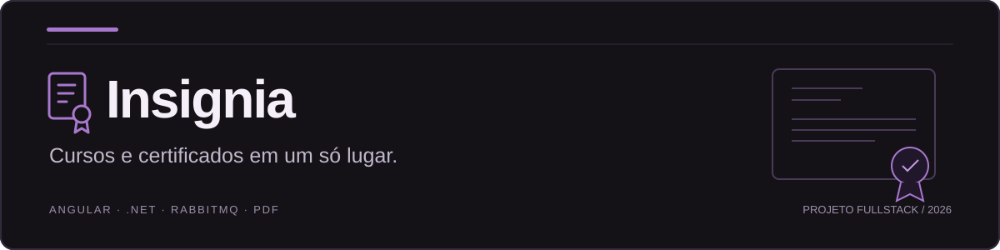
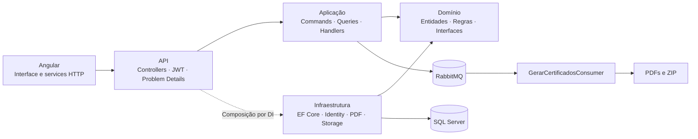
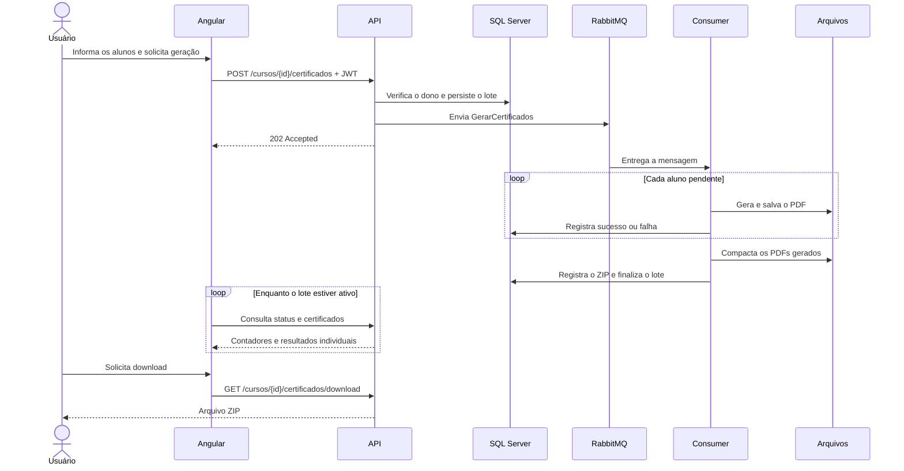

<div align="center">



<p>
  
  
  
  
  
</p>

**Cadastre cursos. Informe os alunos. Acompanhe a geração. Baixe os certificados.**

[Funcionalidades](#funcionalidades) · [Arquitetura](#arquitetura) · [Executar localmente](#executar-localmente) · [API](#api) · [Testes](#testes) · [Deploy](#deploy)

</div>

---

## Sobre

O **Insignia** é uma aplicação fullstack para gerenciar cursos e emitir certificados de conclusão. A interface permite cadastrar um curso, enviar os nomes dos alunos e acompanhar a geração dos PDFs até o download de um arquivo ZIP.

Os certificados são processados em segundo plano com **RabbitMQ e MassTransit**. A API aceita a solicitação, enquanto um consumer gera os documentos, registra o resultado de cada aluno e prepara o arquivo para download.

Projeto desenvolvido por [Kauan Silva](https://github.com/k-silvax19) durante a formação Fullstack da [Academia do Programador](https://www.academiadoprogramador.net), com evolução da interface, integração dos certificados, isolamento por usuário e testes de acesso.

## Funcionalidades

| Área                   | O que está implementado                                               |
| ---------------------- | --------------------------------------------------------------------- |
| **Conta**              | Cadastro, login com JWT, persistência da sessão e saída da conta      |
| **Cursos**             | Cadastro, listagem por usuário e consulta de detalhes                 |
| **Certificados**       | Geração para um aluno ou uma turma, com um nome por linha             |
| **Acompanhamento**     | Atualização automática, contadores, progresso e resultado individual  |
| **Download**           | ZIP com os PDFs gerados com sucesso                                   |
| **Controle de acesso** | Verificação do dono do curso no backend, incluindo geração e download |
| **Interface**          | Tema escuro, destaques em roxo, menu lateral e adaptação para celular |
| **Integração**         | OpenAPI, Swagger UI, Problem Details e exemplos de requisições HTTP   |

### Um fluxo completo pela interface

1. Crie uma conta e faça login.
2. Cadastre o curso com nome, carga horária e data de conclusão.
3. Abra os detalhes e informe os alunos, um por linha.
4. Envie a solicitação e acompanhe o processamento.
5. Quando o ZIP estiver disponível, clique em **Baixar todos (ZIP)**.

A tela recupera o lote mais recente ao ser aberta. Durante a geração, consulta a API a cada **dois segundos** e impede o envio de outra solicitação pelo formulário.

## Tecnologias

| Camada           | Tecnologias                                              |
| ---------------- | -------------------------------------------------------- |
| **Frontend**     | Angular 22, TypeScript 6, RxJS, Signals e Signal Forms   |
| **Estilização**  | Tailwind CSS 4 e ícones Lucide                           |
| **API**          | ASP.NET Core / .NET 10, JWT Bearer, OpenAPI e Swagger UI |
| **Aplicação**    | MediatR, FluentResults e MassTransit                     |
| **Persistência** | Entity Framework Core 10, SQL Server e migrations        |
| **Identidade**   | ASP.NET Core Identity                                    |
| **Mensageria**   | RabbitMQ, local ou hospedado, como no CloudAMQP          |
| **Documentos**   | QuestPDF e compactação ZIP no sistema de arquivos        |
| **Testes**       | MSTest, ASP.NET Core TestServer, SQLite em memória e Moq |

## Arquitetura

O backend é organizado em quatro camadas, com módulos por funcionalidade. Os controllers encaminham os casos de uso ao MediatR; os handlers aplicam as regras e utilizam os contratos definidos no domínio.



| Projeto                                       | Responsabilidade                                                       |
| --------------------------------------------- | ---------------------------------------------------------------------- |
| [`Api`](server/src/Api)                       | Contratos HTTP, autenticação JWT, documentação e respostas da API      |
| [`Aplicacao`](server/src/Aplicacao)           | Casos de uso, DTOs, handlers e processamento da mensagem de geração    |
| [`Dominio`](server/src/Dominio)               | Cursos, certificados, processamentos, validações e interfaces          |
| [`Infraestrutura`](server/src/Infraestrutura) | Banco de dados, repositórios, Identity, geração de PDF e armazenamento |

O domínio não depende de ASP.NET Core ou EF Core. A aplicação utiliza interfaces do domínio para acessar persistência, identidade e arquivos.

### Organização do repositório

```text
Insignia/
├── client/
│   └── src/
│       ├── app/
│       │   ├── auth/                  # Login, cadastro, sessão e interceptor
│       │   ├── certificados/          # Solicitação, acompanhamento e download
│       │   ├── cursos/                # Cadastro, listagem e detalhes
│       │   ├── home/                  # Página inicial
│       │   └── shared/navbar/         # Navegação compartilhada
│       ├── environments/              # Endereços da API
│       └── styles.css                 # Tailwind e estilos globais
├── server/
│   ├── src/
│   │   ├── Api/
│   │   ├── Aplicacao/
│   │   ├── Dominio/
│   │   └── Infraestrutura/
│   ├── tests/GeradorCertificadosOnline.Tests/
│   └── GeradorCertificadosOnline.slnx
└── docs/assets/                       # Recursos da documentação
```

### Padrões do frontend

- Componentes standalone e carregamento de páginas sob demanda.
- Injeção de dependências com `inject()`.
- Estado com `signal()` e valores derivados com `computed()`.
- Formulários com Signal Forms e validação por campo.
- Services HTTP e interfaces TypeScript separados por funcionalidade.
- Templates com `@if`, `@for` e classes utilitárias do Tailwind.
- Acompanhamento com RxJS, sem sobrepor rodadas de consulta, e cancelamento ao destruir o componente.

## Geração dos certificados



### Regras do processamento

- Um curso pode ter vários lotes finalizados, mas apenas **um lote ativo por vez**.
- Cada solicitação exige ao menos um aluno; nomes têm limite de **200 caracteres**.
- O PDF utiliza os dados do curso e o nome do aluno, em formato **A4 paisagem**.
- Falhas individuais não interrompem os demais certificados.
- O ZIP inclui os PDFs gerados com sucesso, mesmo quando o lote termina com falhas.
- A mensagem pode ser reentregue: o consumer retoma somente certificados pendentes e ignora lotes finalizados.
- Falhas estruturais usam retentativas com intervalos de **5, 15 e 30 segundos**.
- O download só é liberado quando o lote estiver finalizado e o ZIP disponível.

| Estado do lote        | Significado                                      |
| --------------------- | ------------------------------------------------ |
| `Pendente`            | Solicitação registrada, aguardando processamento |
| `GerandoCertificados` | Geração dos documentos em andamento              |
| `Concluido`           | Lote finalizado sem falhas individuais           |
| `ConcluidoComFalhas`  | Lote finalizado com falhas em um ou mais alunos  |

Cada certificado possui seu próprio estado: `Pendente`, `Gerado` ou `Falha`.

### Armazenamento

A implementação utiliza `Environment.SpecialFolder.LocalApplicationData`, sob a pasta `GeradorCertificadosOnline/storage` do usuário que executa a API:

```text
storage/
└── {cursoId}/
    ├── {certificadoId}.pdf
    ├── {certificadoId}.pdf
    └── certificados-{processamentoId}.zip
```

O nome técnico `GeradorCertificadosOnline` permanece nos projetos .NET e no diretório de armazenamento. **Insignia** é a identidade apresentada na interface.

## Executar localmente

### Pré-requisitos

- **.NET SDK 10**.
- **Node.js 24.15 ou superior na linha 24**, compatível com o Angular utilizado, e npm.
- Uma instância de **SQL Server** acessível.
- Uma instância de **RabbitMQ**, local ou hospedada.

O uso de Docker é opcional para disponibilizar os serviços; não há configuração de containers incluída neste checkout.

### 1. Obter o projeto

```bash
git clone https://github.com/k-silvax19/Certifica-.git
cd Certifica-
```

### 2. Configurar o backend

Execute na pasta `server`:

```powershell
cd server
dotnet restore GeradorCertificadosOnline.slnx
dotnet tool restore
```

Use User Secrets para os valores locais. Substitua os exemplos entre `<...>` pelas suas configurações:

```powershell
dotnet user-secrets set "ConnectionStrings:SqlServer" "Server=localhost,1433;Database=GeradorDeCertificadosDb;User Id=<USUARIO>;Password=<SENHA>;TrustServerCertificate=True" --project src/Api
dotnet user-secrets set "ConnectionStrings:RabbitMq" "amqps://<USUARIO>:<SENHA>@<HOST>/<VHOST>" --project src/Api
dotnet user-secrets set "Jwt:SigningKey" "<CHAVE_ALEATORIA_COM_PELO_MENOS_32_BYTES>" --project src/Api
dotnet user-secrets set "Cors:AllowedOrgins:0" "http://localhost:4200" --project src/Api
```

A chave CORS é `AllowedOrgins`, com essa grafia, conforme a configuração atual. `Jwt:Issuer`, `Jwt:Audience` e `Jwt:ExpiresInMinutes` também precisam estar configurados; os valores padrão ficam em `appsettings.json`.

Ative o ambiente local e aplique as migrations:

```powershell
$env:ASPNETCORE_ENVIRONMENT = "Development"
dotnet ef database update --project src/Infraestrutura --startup-project src/Api
dotnet run --project src/Api --launch-profile http
```

No ambiente `Development`, a API também aplica migrations ao iniciar. SQL Server e RabbitMQ precisam estar disponíveis; o host aguarda a conexão com o broker na inicialização.

### 3. Iniciar o frontend

Em outro terminal, a partir da raiz:

```powershell
cd client
npm ci
npm start
```

No PowerShell com execução de scripts `.ps1` bloqueada, use `npm.cmd ci` e `npm.cmd start`.

| Serviço           | Endereço local                                                          |
| ----------------- | ----------------------------------------------------------------------- |
| Interface Angular | [localhost:4200](http://localhost:4200)                                 |
| API               | [localhost:5146](http://localhost:5146)                                 |
| Swagger UI        | [localhost:5146/swagger](http://localhost:5146/swagger)                 |
| OpenAPI           | [localhost:5146/openapi/v1.json](http://localhost:5146/openapi/v1.json) |

### Rotas da interface

| Rota                        | Tela                                                |
| --------------------------- | --------------------------------------------------- |
| `/`                         | Início                                              |
| `/cadastro`                 | Cadastro de conta                                   |
| `/login`                    | Login                                               |
| `/cursos/listar`            | Cursos do usuário                                   |
| `/cursos/cadastrar`         | Cadastro de curso                                   |
| `/cursos/detalhes/:cursoId` | Detalhes, geração e acompanhamento dos certificados |

Os links de cursos no menu aparecem somente para usuários autenticados. A autorização dos dados é verificada no backend.

## API

Os endpoints de cursos e certificados exigem `Authorization: Bearer <TOKEN>`. Cadastro e login permitem acesso anônimo. Na configuração atual, Swagger e OpenAPI também estão públicos.

| Método | Endpoint                                  | Resposta de sucesso                       |
| ------ | ----------------------------------------- | ----------------------------------------- |
| `POST` | `/auth/cadastro`                          | `201` — usuário criado                    |
| `POST` | `/auth/login`                             | `200` — token JWT                         |
| `GET`  | `/cursos`                                 | `200` — cursos do usuário                 |
| `POST` | `/cursos`                                 | `201` — curso criado                      |
| `GET`  | `/cursos/{cursoId}`                       | `200` — dados do curso                    |
| `POST` | `/cursos/{cursoId}/certificados`          | `202` — geração solicitada                |
| `GET`  | `/cursos/{cursoId}/status`                | `200` — lote mais recente                 |
| `GET`  | `/cursos/{cursoId}/certificados`          | `200` — certificados do lote mais recente |
| `GET`  | `/cursos/{cursoId}/certificados/download` | `200` — ZIP dos certificados              |

<details>
<summary><strong>Exemplos dos contratos JSON</strong></summary>

**Cadastro ou login**

```json
{
  "email": "usuario@exemplo.com",
  "senha": "<SUA_SENHA>"
}
```

A senha de cadastro deve ter ao menos oito caracteres, um número e um símbolo.

**Cadastro de curso**

```json
{
  "nome": "Desenvolvimento Web Full Stack",
  "cargaHoraria": 120,
  "dataConclusao": "2026-12-15"
}
```

O usuário proprietário é obtido do JWT; não é informado pelo frontend.

**Solicitação de certificados**

```json
{
  "alunos": [{ "nome": "Ana Silva" }, { "nome": "João Souza" }]
}
```

O retorno `202` confirma o recebimento da solicitação. Consulte `/status` até `zipDisponivel` ser `true` antes de baixar.

</details>

Erros seguem `application/problem+json`. As respostas de validação incluem mensagens por campo; recursos que não pertencem ao usuário retornam `404`. Tentar iniciar outro lote ativo ou baixar um ZIP ainda indisponível retorna `409`.

Mais exemplos estão em [`GeradorCertificadosOnline.Api.http`](server/src/Api/GeradorCertificadosOnline.Api.http).

## Autenticação e acesso aos dados

- Senhas gerenciadas pelo ASP.NET Core Identity, com bloqueio temporário após tentativas inválidas.
- JWT com validação de assinatura, emissor, audiência e expiração.
- Token enviado pelo interceptor HTTP do Angular e sessão mantida no `localStorage`.
- Cursos vinculados ao usuário autenticado e consultas filtradas por esse vínculo.
- Geração, status, listagem e download de certificados protegidos pelo dono do curso.
- Cursos anteriores à migration de propriedade permanecem sem dono e ficam ocultos até uma associação explícita.
- Referência à versão `9.0.21` de `System.Security.Cryptography.Pkcs` para corrigir a dependência transitiva do SqlClient identificada na auditoria.

## Testes

A suíte atual possui **sete testes de integração de isolamento entre contas**, usando JWT real, ASP.NET Core TestServer, SQLite em memória e substitutos para mensageria e arquivos.

Ela verifica listagem por usuário, vínculo de novos cursos ao token, tentativa de alterar o dono pelo JSON, bloqueio de acesso por ID de outra conta, geração indevida, acesso do proprietário, cursos legados e requisições sem token.

Execute a partir da raiz:

```powershell
dotnet test server/GeradorCertificadosOnline.slnx --configuration Release
```

Os testes não exigem SQL Server ou RabbitMQ em execução. A geração real de PDFs e o funcionamento do broker devem ser verificados com os serviços disponíveis.

### Compilação e auditoria

```powershell
dotnet build server/GeradorCertificadosOnline.slnx --configuration Release
dotnet list server/GeradorCertificadosOnline.slnx package --vulnerable --include-transitive
```

Para o frontend, dentro de `client`:

```powershell
npm run build
```

Os arquivos de produção são gerados em `client/dist/gerador-certificados`; a saída web fica em sua pasta `browser` no builder de aplicação do Angular.

## Deploy

O fluxo de produção utilizado no projeto é feito com **GitHub Actions**, fornecendo as configurações sensíveis por **GitHub Secrets** e variáveis de ambiente.

| Configuração .NET             | Variável de ambiente                |
| ----------------------------- | ----------------------------------- |
| `ConnectionStrings:SqlServer` | `ConnectionStrings__SqlServer`      |
| `ConnectionStrings:RabbitMq`  | `ConnectionStrings__RabbitMq`       |
| `Jwt:SigningKey`              | `Jwt__SigningKey`                   |
| `Jwt:Issuer`                  | `Jwt__Issuer`                       |
| `Jwt:Audience`                | `Jwt__Audience`                     |
| `Jwt:ExpiresInMinutes`        | `Jwt__ExpiresInMinutes`             |
| `Cors:AllowedOrgins:0`        | `Cors__AllowedOrgins__0`            |
| Ambiente                      | `ASPNETCORE_ENVIRONMENT=Production` |

Os secrets devem ser mapeados pelo workflow para a configuração da aplicação na hospedagem. Valores definidos somente no processo de build não ficam automaticamente disponíveis no servidor em execução.

<details>
<summary><strong>Configurações para conferir antes de publicar</strong></summary>

- Configurar a origem real do frontend no CORS e exigir HTTPS na hospedagem.
- Aplicar migrations durante o processo de implantação: a aplicação só as executa automaticamente em `Development`.
- Garantir armazenamento persistente e permissões para gravar PDFs e ZIPs.
- O consumer é registrado no mesmo host da API; não há um projeto separado de worker neste checkout.
- O template dos certificados é fixo no código e não representa uma assinatura digital criptográfica.
- Há arquivos de ambiente para o Angular, mas `app.config.ts` importa diretamente `environment.development`. Ajuste essa seleção antes do build de produção para utilizar o endereço publicado da API.
- Configurações incluídas no frontend são públicas; secrets pertencem ao backend e à infraestrutura.

</details>

## Escopo atual

A aplicação cobre cadastro e consulta de cursos, geração e download de certificados. Edição e exclusão de cursos, histórico de lotes na interface, download individual de PDF e personalização de templates ainda não estão implementados.

O acompanhamento é feito por consultas periódicas HTTP. O envio da mensagem ocorre após a persistência do lote, sem outbox transacional na implementação atual.

---

<div align="center">

**Insignia** · Projeto Fullstack 2026

Desenvolvido por [Kauan Silva](https://github.com/k-silvax19) na formação da [Academia do Programador](https://www.academiadoprogramador.net).

</div>
